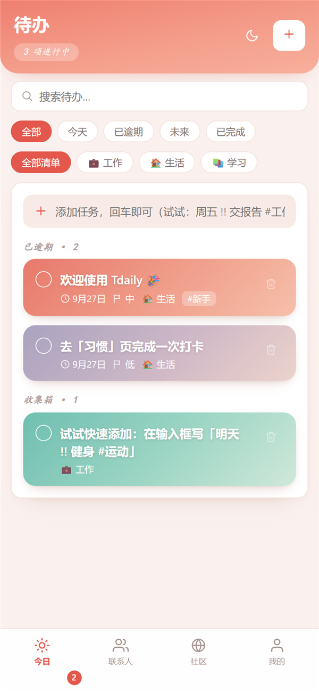
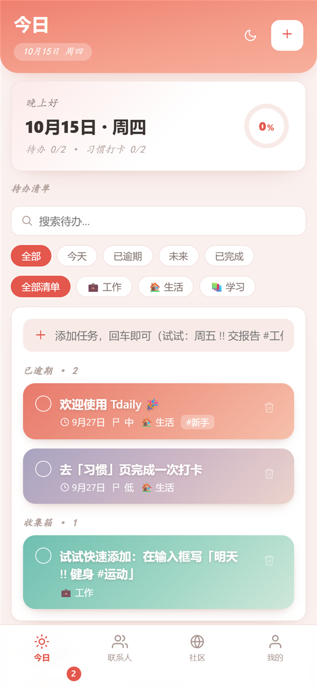
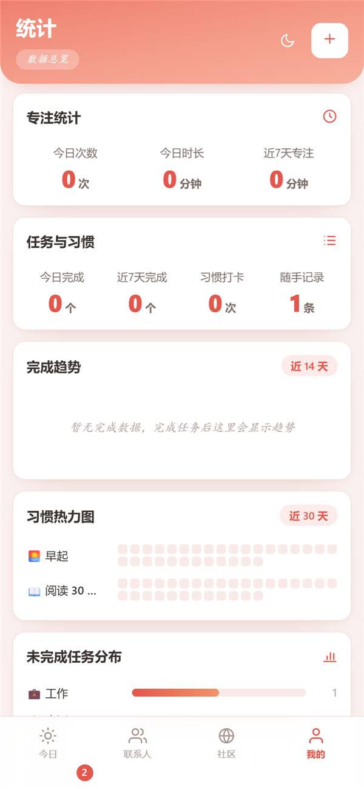

# Tdaily · 日常系统

一个轻量的个人日常管理系统：**待办 / 习惯打卡 / 随记 / 日历 / 统计 / 专注番茄钟**，另外还带班级事务与熟人社区小功能。
一套 Node 服务端 + Web 前端，同时支持 **浏览器 / Android App / Windows 桌面端** 三端使用，数据保存在你自己的服务器上。

<p>
  
  
  
</p>

## ✨ 功能一览

- **今日**：问候语、完成进度环、待办清单、习惯打卡、番茄钟、快速记录
- **待办**：优先级（高/中/低）、标签、清单分组、重复任务、搜索与筛选
- **习惯**：每日打卡、连续天数、30 天热力图
- **记录**：心情 + 标签的随手记
- **日历**：按天回看完成情况与记录
- **统计**：任务完成趋势、习惯热力图、专注时长统计、未完成分布
- **专注番茄钟**：15 / 25 / 45 / 60 分钟，完成后自动记录时长
- **社区**：帖子、点赞、评论、多人聊天室、好友私聊
- **班级**：创建/加入班级（班级码 + 学号）、资料收集、投票、随机抽人、名单 Excel 导入
- **多账号**：每个账号数据独立，支持浅色/深色/跟随系统与自定义主题色

## 🚀 快速开始

### 本地运行

需要 Node.js 18+（零第三方依赖）：

```bash
node server.js
```

然后打开 http://localhost:3888 ，注册的第一个账号会自动成为管理员。
Windows 下也可以直接双击 `启动Tdaily.bat`。

### Docker 部署

```bash
docker compose up -d --build
```

数据挂载在 `./data` 目录。需要 HTTPS 可参考 `Caddyfile.example` 与 `docker-compose.https.yml`（Caddy 自动签发证书）。

### 常用环境变量

| 变量 | 说明 |
| --- | --- |
| `PORT` | 服务端口，默认 `3888` |
| `TD_INVITE` | 设置后注册需要邀请码 |

## 📱 三端使用

| 端 | 目录 | 说明 |
| --- | --- | --- |
| 浏览器 | `public/` | 直接访问服务器地址即可；手机可"添加到主屏幕"当作 PWA 使用 |
| Windows | `desktop/` | Electron 壳：`npm install && npm run dist`；服务地址通过 `TDAILY_URL` 环境变量指定 |
| Android | `android-app/` | WebView 壳：构建前先把 `MainActivity.java` 里的 `APP_URL` 改成你的服务器地址；签名信息读取 `keystore.properties`（已 gitignore，不入库） |

## 🗂 项目结构

```
server.js      # Node 服务端（静态资源 + REST API，单文件零依赖）
public/        # Web 前端（原生 HTML/CSS/JS，无前端框架）
desktop/       # Electron 桌面端
android-app/   # Android WebView 客户端
tools/         # 图标生成等小工具
docs/          # 文档与界面截图
data/          # 运行时数据（不入库，首次运行自动创建）
```

## 🔐 数据与隐私

- 所有数据（账号、待办、聊天等）都保存在你自己服务器的 `data/` 目录，不依赖任何第三方服务
- 本仓库不包含任何用户数据、服务器地址与密钥信息

## 📄 License

暂未添加开源许可证。
